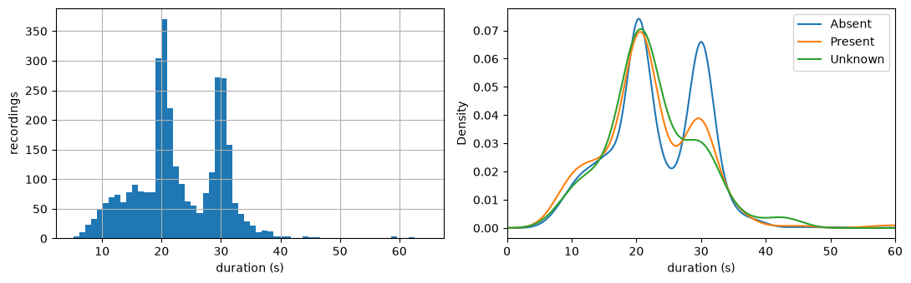
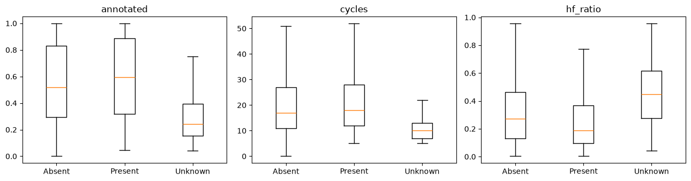
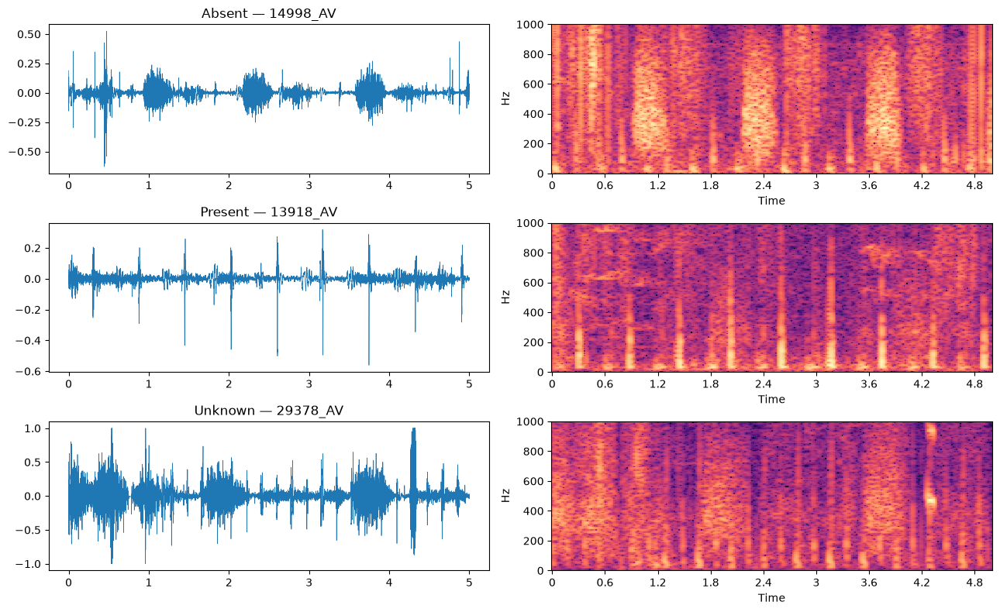

# 01 — Análise exploratória dos dados (EDA)

**Notebook:** [`notebooks/01_eda.ipynb`](../notebooks/01_eda.ipynb)
**Dados:** CirCor DigiScope v1.0.3, parte pública: 942 pacientes, 3163 gravações

O notebook segue sempre o mesmo padrão: **olhar → medir → tirar uma consequência para o desenho do modelo**.
Cada secção responde a uma pergunta que o projeto nos obriga a responder.

| Pergunta | Secção |
|---|---|
| Como trato o desequilíbrio? | 1 |
| Que entrada dou à rede? | 2, 4, 6 |
| Que rótulo dou a cada gravação? | 3 |
| Como chego a uma previsão por paciente? | 2, 3 |
| Porque é que o Unknown é tão difícil? | 5 |
| A avaliação é justa? | 7 |

---

## 0. Setup

```python
import sys; sys.path.insert(0, '..')
from src.data import load_patients, load_recordings, load_split, WAV_DIR
from src.metrics import weighted_accuracy
```

- **O quê:** junta a pasta-mãe ao path, para poder importar o módulo `src/`.
- **Porquê:** a EDA usa as mesmas funções de leitura de dados e a mesma métrica que os modelos vão usar. Um bug na leitura aparece já aqui e não só no treino.

---

## 1. Pacientes e rótulos

### 1a. Contagem das classes

| Murmur | Pacientes | % |
|---|---|---|
| Absent | 695 | 73.8 |
| Present | 179 | 19.0 |
| Unknown | 68 | 7.2 |

**Porquê:** o dataset está muito desequilibrado. Vamos ter de usar pesos na loss ou amostragem balanceada.

### 1b. Baselines triviais

WA de um "modelo" que prevê sempre a mesma classe:

| Prevê sempre | WA |
|---|---|
| Absent | 0.387 |
| Present | **0.499** |
| Unknown | 0.114 |

**Porquê:** dá o patamar mínimo a bater.
- A accuracy normal de prever sempre Absent seria 74%, mas a WA dá só 0.387, porque cada Present conta 5 vezes e cada Unknown conta 3.
- **Um modelo abaixo de ~0.50 é pior do que prever sempre Present.**

### 1c. Idade × Murmur

Tabela cruzada com a contagem de cada classe por grupo etário. É uma primeira pista de que o Unknown não está distribuído ao acaso; confirma-se na secção 5.

---

## 2. Gravações

### 2a. Inventário

`load_recordings()` lista os `.wav`. O nome de cada ficheiro dá o paciente e a localização (`50704_AV.wav` → paciente 50704, válvula aórtica). `sf.info` lê a taxa de amostragem e a duração sem carregar o áudio.

- Todas as gravações estão a **4000 Hz**, por isso não é preciso reamostrar. Também se pode reduzir a taxa sem perder informação, porque os sons cardíacos estão bem abaixo de 2000 Hz.
- **Número de gravações por paciente:**

| Gravações | 1 | 2 | 3 | 4 | 5 | 6 |
|---|---|---|---|---|---|---|
| Pacientes | 62 | 156 | 123 | 588 | 10 | 3 |

### 2b. Durações e localizações

- **Duração:** entre 5.2 e 64.5 s, com mediana de 21.5 s.
- **Localizações:** MV 861, AV 800, PV 766, TV 732 e Phc 4.

**Porquê:**
- As redes precisam de entradas com tamanho fixo → **cortar em janelas de tamanho fixo** (p.ex. 4 s).
- O número de gravações varia de paciente para paciente → é preciso decidir como **agregar** os resultados por paciente.

### 2c. Histogramas



Serve para confirmar que a duração não denuncia a classe. Se denunciasse, o modelo podia aprender um atalho em vez de aprender a ouvir o sopro.

---

## 3. Murmur locations (ruído nos rótulos)

### 3a. Localizações gravadas vs. localizações com sopro

Para os pacientes Present, muitos têm sopro só em parte das localizações. Por exemplo, há 12 pacientes com 4 gravações e sopro em apenas 1.

### 3b. Rótulo por gravação

```python
rec['murmur_here'] = [m == 'Present' and loc in mloc[p] ...]
```

Para cada gravação, verifica se a sua localização aparece no campo `Murmur locations` do paciente.

- Das 616 gravações de pacientes Present, **117 (19%) não têm sopro audível**.
- Isto afeta **68 dos 179** pacientes Present.

**Porquê:** se cada gravação herdasse o rótulo do paciente, a rede seria treinada a dizer "Present" para gravações sem sopro, o que é ruído nos rótulos. Com `murmur_here` passamos a ter rótulos limpos por gravação. A previsão por paciente obtém-se depois agregando, por exemplo "Present se alguma gravação for Present".

### 3c. Grau do sopro

| Systolic murmur grading | Pacientes |
|---|---|
| I/VI | 104 |
| III/VI | 46 |
| II/VI | 28 |

A maioria dos sopros é de grau I/VI, ou seja, quase inaudível. O sinal a detetar é subtil, o que ajuda a explicar porque é que os resultados não vão ser perfeitos.

---

## 4. Ficheiros de segmentação (.tsv)

Cada gravação vem com um `.tsv`. Cada linha é um intervalo `start, end, state`:

| state | significado |
|---|---|
| 0 | não anotado |
| 1 | S1 |
| 2 | sístole |
| 3 | S2 |
| 4 | diástole |

Tem duas utilidades:
1. Pode servir para cortar janelas alinhadas com os batimentos, o que é útil para um RNN que processa ciclo a ciclo.
2. Serve como medida aproximada de qualidade da gravação (secção 5).

---

## 5. Qualidade do sinal e a classe Unknown

### 5a. Três indicadores de qualidade por gravação

| Indicador | Como se calcula | Intuição |
|---|---|---|
| `annotated` | fração do tempo com `state > 0` no `.tsv` | se a segmentação não encontrou batimentos, o sinal é mau |
| `cycles` | número de segmentos S1 | quantos batimentos foram reconhecidos |
| `hf_ratio` | fração da potência acima de 400 Hz (espectro calculado com `welch`) | os sons cardíacos e os sopros estão abaixo de ~400 Hz; acima disso é sobretudo choro, fala ou fricção |

### 5b. Resultados (medianas por gravação)

| | Absent | Present | Unknown |
|---|---|---|---|
| Fração segmentável | 0.52 | 0.60 | **0.24** |
| Ciclos cardíacos | 17 | 18 | **10** |
| Energia > 400 Hz | 0.27 | 0.19 | **0.45** |



**Conclusão:** o **Unknown é sobretudo uma classe de "má gravação"** e não um padrão fisiológico.
- **Não filtrar em excesso** (p.ex. com um passa-banda estreito), porque o ruído é a pista para identificar o Unknown.
- Indicadores de qualidade como estes podem servir de entrada extra para o modelo.

> Nota: `annotated` e `cycles` vêm da segmentação dos `.tsv`, que foi feita automaticamente. São medidas aproximadas da qualidade, não medidas diretas.

### 5c. Taxa de Unknown por idade

| Idade | Absent | Present | Unknown |
|---|---|---|---|
| Adolescent | 0.74 | 0.22 | 0.04 |
| Child | 0.75 | 0.20 | 0.06 |
| Infant | 0.60 | 0.20 | **0.20** |
| Neonate | 0.67 | 0.17 | 0.17 |

Os bebés têm ~3× mais Unknown do que as crianças, o que é coerente com choro e movimento durante a gravação.

---

## 6. Sinais de exemplo



Para um exemplo de cada classe: os primeiros 5 s da onda (à esquerda) e o espectrograma STFT de 0 a 1000 Hz (à direita).
- Na onda vêem-se os picos S1/S2.
- No espectrograma vê-se onde está a energia.
- Isto motiva usar o **mel-spectrograma** como entrada da CNN: é uma versão comprimida do espectrograma, com mais resolução nas frequências baixas, que são as que interessam.

---

## 7. Verificação do split

| fold | Absent | Present | Unknown | Total |
|---|---|---|---|---|
| −1 (test) | 139 | 36 | 14 | 189 |
| 0 | 111 | 29 | 11 | 151 |
| 1 | 112 | 28 | 11 | 151 |
| 2 | 111 | 28 | 11 | 150 |
| 3 | 111 | 29 | 11 | 151 |
| 4 | 111 | 29 | 10 | 150 |

O split está estratificado: todos os folds têm proporções parecidas. Sem esta verificação, um fold com só 3 Unknown daria uma WA muito instável.
O split é feito por paciente, e os pacientes com `Additional ID` (a mesma criança nas duas campanhas) ficam no mesmo grupo, para evitar leakage.

---

## Conclusões / decisões

1. **Desequilíbrio vs. métrica:** 74/19/7%, e prever sempre Present dá WA = 0.499.
   → pesos de classe ou amostragem balanceada; thresholds afinados em CV para maximizar a WA.
2. **Rótulos por paciente:** 19% das gravações de pacientes Present não têm sopro audível, e a maioria dos sopros é de grau I/VI.
   → treinar com rótulos por gravação (`Murmur locations`) e agregar por paciente.
3. **Unknown ≈ má gravação:** menos sinal segmentável, menos ciclos, mais ruído acima de 400 Hz, e concentrado em bebés.
   → não filtrar o ruído em excesso; considerar indicadores de qualidade.
4. **Entradas:** áudio a 4 kHz, gravações de 5 a 64 s, ~4 localizações por paciente.
   → janelas fixas de ~4 s; a informação útil está na banda ~25–400 Hz.

## Próximos passos

- Pipeline de pré-processamento: janelas, normalização e mel-spectrogramas/MFCCs.
- Primeiro modelo (CNN 2D sobre mel-spectrogramas) com treino em 5 folds, agregação por paciente e WA em CV.
